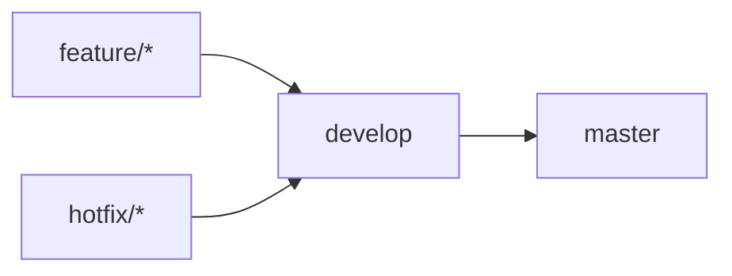
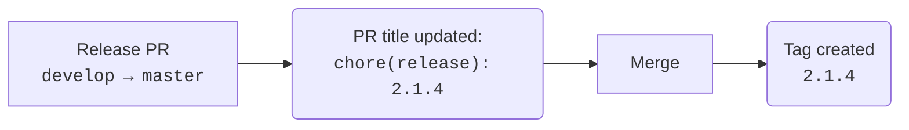

# Two-stage Versioning Workflow

Zero-dependency GitHub Actions workflow template for semi-automated semantic versioning and release tagging using `develop → master`.

Unlike fully automated release systems, this workflow only automates the repetitive parts of the release process. The version number itself remains a deliberate human decision.

> ### Why Not Fully Automated Versioning?
>
> This template intentionally does not determine release types from commit history.
> Instead, it automatically suggests the next patch version, which is the most common case, while leaving the final version number under the developer's control.
>
> Minor and major version bumps remain a deliberate human decision.

## Features

- Zero external dependencies
- Automatic patch version suggestion
- Manual minor/major version selection
- Automatic release PR title generation
- Automatic version tag creation
- Idempotent tag creation
- Safe failure when release metadata is invalid
- No GitHub Apps or Personal Access Tokens
- No Conventional Commits required
- No changelog generation

## Installation

Copy the two files from this template's [`.github/workflows/`](.github/workflows/) directory into your repository's `.github/workflows/` directory:

- `release-pr-title.yml`
- `release-tag.yml`

Create the `develop` and `master` branches if they do not already exist. If you use different branch names, update both workflow files accordingly.

Configure **Pull request title** as the default merge commit message in your repository settings so release titles are preserved when merging.

## Intended Workflow

This template assumes the following branching strategy:



## How It Works

Development takes place on `develop`. Release changes reach `master` through a pull request directly from `develop`.



### 1. Create a Release PR

Create a pull request from `develop` to `master`.

The [Release PR Title workflow](.github/workflows/release-pr-title.yml) reads the latest Git tag, suggests the next patch version and automatically updates the PR title:

```text
chore(release): 2.1.4
```

If there are no tags yet, the suggested version is `0.1.0`.

### 2. Optionally Change the Version

If the release should be a minor or major release, edit the PR title before merging:

```text
chore(release): 3.0.0
```

The title is set only when the PR is opened, so later manual edits are preserved.

### 3. Merge into Master

Merge the PR normally. The resulting commit must preserve the PR title, for example:

```text
chore(release): 2.1.4 (#42)
```

Both merge commits and squash merges are supported as long as the resulting commit title preserves the release title.

After a successful merge, the [Release Tag workflow](.github/workflows/release-tag.yml) validates the merged commit title, extracts its version number and creates the tag on that commit:

```text
2.1.4
```

Closing a PR without merging does not create a tag.

## Versioning Philosophy

The workflow automatically recommends the next **patch** version.
Patch releases require no manual changes in the common case.

If the release should instead be **minor** or **major**, simply edit the release PR title before merging.

Example:

```text
Suggested:
2.4.8

Changed manually:
2.5.0
```

The workflow intentionally never decides whether a release is major, minor, or patch.

## Requirements

The workflow assumes that:

- Git tags are used for released versions.
- Tags do not use a `v` prefix (e.g. `2.1.2`, not `v2.1.2`).
- Release PR titles follow the format `chore(release): x.y.z`.
- The merged commit preserves the release title. GitHub's default merge settings satisfy this requirement for both merge commits and squash merges.

## Safety

Several validation steps prevent incorrect releases.

The workflow:

- validates release commit titles using a regular expression
- never overwrites an existing tag
- succeeds when re-run on the same commit
- fails if an existing tag points to another commit

This makes the tagging workflow idempotent and safe to re-run.

## Customization

The implementation is intentionally minimal.

Most projects only may need to modify:

- branch names
- commit title format
- release prefix
- adding a `v` tag prefix
- version bump logic

The workflows are intentionally small and can usually be understood and customized in just a few minutes.

[Back to the template overview](../../README.md).
